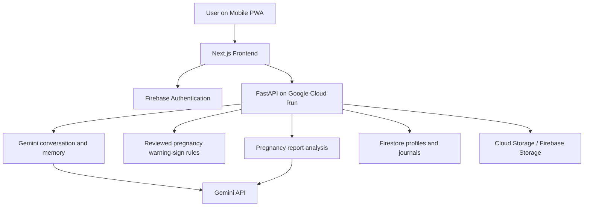

# System architecture

## App journey
Signup/login -> onboarding (language, consent, relevant details) -> select menstrual/pregnancy/postpartum -> stage-specific dashboard. Settings allow switching stage at any time. The same account persists; previous stage data is retained.

**Functional scope:** Pregnancy voice, safety, reports and timeline. Menstrual/Postpartum routes and onboarding work, but unimplemented services display Coming Soon.

## Firestore proposed schema
- `users/{uid}`: `active_stage`, `locale`, consent preferences, timestamps.
- `users/{uid}/stage_profiles/{stage}`: stage-specific profile fields. Pregnancy may store `gestational_week` if user shares it.
- `users/{uid}/conversations/{id}`: opted-in messages and bounded summaries.
- `users/{uid}/symptom_entries/{id}`: consented journal records.
- `users/{uid}/reports/{id}`: user-owned report metadata, extracted factual fields and citations.
- `users/{uid}/care_events/{id}`: appointment notes / safety handoff events.

## Security and health boundaries
All protected calls use a verified Firebase bearer token. Never accept arbitrary client-supplied user IDs. Files stay private; enforce per-user access controls, upload validation and data retention. Never commit secrets. AI must not diagnose or prescribe. Reviewed red-flag rules override AI output. Use only synthetic data for demo; don't claim report extraction is clinically validated.
